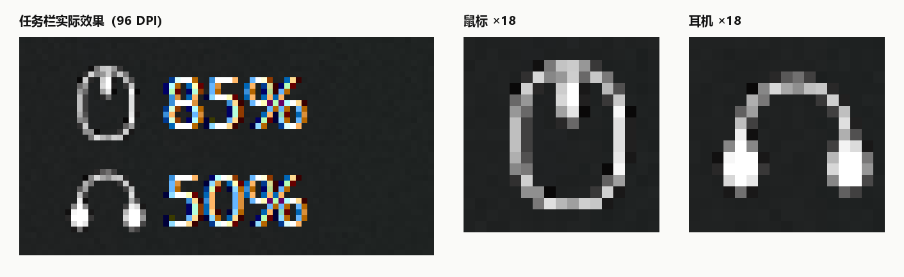

# TrafficMonitor-WirelessBattery

给 [TrafficMonitor](https://github.com/zhongyang219/TrafficMonitor) 用的插件：在任务栏上显示**无线鼠标**和**无线耳机**的剩余电量。

不依赖 Python 常驻进程，电量由 DLL 直接通过 Windows HID API 读取；图标是自绘的矢量细线图标，随 DPI 缩放。



## 功能

- 两个独立显示项：`鼠标电量`（`WB_MOUSE_BATTERY`）、`耳机电量`（`WB_HEADSET_BATTERY`），可分别开关、单独放置
- 每 15 秒刷新一次，读不到时显示 `--`
- 图标与百分比数字在像素级对齐，颜色跟随 TrafficMonitor 的数值文字颜色
- 图标尺寸按 DPI 自动适配（96 DPI 下 14px），并强制取偶数边长——见下文

## 支持的设备

| 设备 | VID:PID | Usage Page | 协议 |
|---|---|---|---|
| AJAZZ 鼠标 | `3151:402D` | `0xFFFF` / usage `0x02` | 先发 `0xF7` 心跳唤醒 2.4G 链路，再读 feature report `0x05`，第 3 字节为电量 |
| MCHOSE 耳机 | `291D:385D` | `0xFF90` / usage `0x01` | 写 64 字节 `55 65 01 ...`，读回 64 字节，第 2 字节（0 基）为电量 |

这两个都是厂商私有约定，不是标准 HID Battery。换成其他型号时，图标与数值照常渲染，但电量会显示 `--`，因为 VID/PID 对不上。要加新设备，在 `ReadMouseBattery()` / `ReadHeadsetBattery()` 旁边加一条分支即可。

## 编译

需要 MinGW-w64（或任意带 GDI+ 的 g++）：

```bash
g++ -shared -O2 -static-libgcc -static-libstdc++ -o WirelessBattery.dll WirelessBattery.cpp \
    -lgdi32 -luser32 -lsetupapi -lhid -luuid -lgdiplus -municode
```

`PluginInterface.h` 是 TrafficMonitor 的插件接口头文件，必须和 cpp 放在同一目录。

## 安装

1. 把 `WirelessBattery.dll` 放进 TrafficMonitor 的 `plugins` 目录（例如 `D:\Program Files (x86)\TrafficMonitor\plugins\`）
2. 重启 TrafficMonitor
3. 右键任务栏 → 选择显示项 → 勾选 `鼠标电量` / `耳机电量`

> 如果 TrafficMonitor 以管理员权限运行，需要用 `explorer.exe` 之类的正常权限方式启动，否则插件窗口挂不到任务栏上。

## 图标渲染

图标不是位图，也不是图标字体，而是用 GDI+ `GraphicsPath` 在 64×64 设计坐标系里画贝塞尔路径，再缩放到实际像素。几个踩过的坑值得记下来：

**1. 线宽必须落在整数像素上**

设计单位下的线宽乘以缩放系数才是屏幕上的墨迹宽度。缩放系数由墨迹包围盒反推：

```
s ≈ 目标边长 / (设计墨迹尺寸 + 笔宽)
```

96 DPI 下取 14px 时，鼠标（外框 37×51）的 `s ≈ 0.2430`。此时：

| 设计笔宽 | 实际墨迹 | 观感 |
|---|---|---|
| 4.0 | 0.97px | 不足 1px，浅色底上弧线看着是断的 |
| 6.0 | 1.44px | 跨两个像素，主体清晰、边缘带抗锯齿灰 |
| 6.5 | 1.58px | 明显更实，但耳罩与头梁腿糊成一块 |
| 7.5 | 1.82px | 内圈被挤窄，发闷 |

当前用 `PEN_MAIN = PEN_BAND = 6.0f`，中缝 `PEN_SEAM = 6.0f`、滚轮 `PEN_WHEEL = 7.4f`，层级保持「外框 ≤ 中缝 < 滚轮」。

**2. 图标边长取偶数**

TrafficMonitor 的两行行高不一定相同（实测鼠标行 15px、耳机行 16px）。图标用 `(行高 - 图标边长) / 2` 做整数除法定位，边长为奇数时必然有一行偏半个像素。所以 `IconSizeForDpi()` 里统一 `s &= ~1`。

**3. 居中余数会被像素栅格量化成台阶**

即使边长取偶数，墨迹高度（13.7px）也没法在 14px 位图里整除，垂直居中会固定偏上半个像素。补偿量**不能靠推算**——`oy` 每变 0.02，图标位图内的墨迹行范围就可能跳一档：

| `oy` 额外偏移 | 位图内墨迹行 | 位图内中心 | 屏幕上是否与数字同轴 |
|---|---|---|---|
| 0.000 – 0.100 | 2..11 | 6.5 | 否（偏上 0.5px） |
| 0.125 – 0.200 | 3..11 | 7.0 | 是 |
| ≥ 0.225 | 3..12 | 7.5 | 否（偏下 0.5px） |

`oy_scan.cpp` 就是干这件事的：离线渲染一串偏移量、打印墨迹行范围，直接读出该取哪一段。当前鼠标取 `+0.5`、耳机取 `+0.16`（取区间正中，微调线宽时不容易跳）。

## 仓库里的其他文件

都是开发过程中用来做视觉比对的小工具，编译后都是独立 exe，与插件无运行时依赖：

| 文件 | 用途 |
|---|---|
| `oy_scan.cpp` | 扫描垂直居中偏移 → 墨迹行范围，用来校准 `oy` |
| `cup_center.cpp` | 扫描耳罩的四种对位方式（外缘固定 / 以头梁腿为轴） |
| `band_pen.cpp` | 扫描头梁笔宽的若干档位 |
| `design.cpp` | 按样式表批量渲染预览图 |
| `preview.cpp` | 渲染 14/16px 的变体位图 |
| `mk_*.py` | 把渲染结果拼成对比图（需要 Pillow） |

编译预览工具：

```bash
g++ -O2 -o oy_scan.exe oy_scan.cpp -lgdi32 -lgdiplus
```

注意：这些工具里的参数是**快照**，改完插件后不会自动同步；要拿来预览当前效果，得手动把参数抄过去，或者直接截图量像素。

## 已知限制

- 只支持上表两种型号，其他设备显示 `--`
- 2.4G 接收器设备需要接收器在位；设备休眠时可能读不到，下一轮刷新会恢复
- 图标造型在 14px 下信息量有限：鼠标只能表达「竖胶囊 + 顶部一条缝」，加滚轮会糊成一根柱
